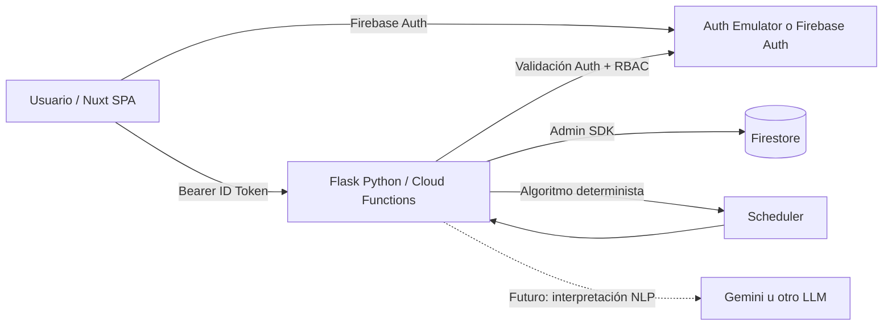

# AulaPlan — Arquitectura técnica de la versión sin IA

## Estructura

```text
aulaplan-mars/
├── apps/
│   ├── api/
│   │   ├── dev.py                    # Flask local
│   │   ├── src/
│   │   │   ├── auth/security.py      # Firebase ID token + RBAC
│   │   │   ├── core/errors.py        # Errores de dominio
│   │   │   ├── firebase/client.py    # Admin SDK + emuladores
│   │   │   ├── http/                 # Rutas, Flask, manejo de errores
│   │   │   ├── repositories/         # Firestore
│   │   │   ├── schemas/catalogs.py   # Pydantic
│   │   │   └── services/            # CRUD + solver determinista
│   │   ├── scripts/                 # create_admin, seed_demo
│   │   └── tests/                   # 10 tests de solver
│   └── web/
│       ├── app/components/catalog/  # Formulario reusable
│       ├── app/pages/               # 13 pantallas
│       ├── app/plugins/             # Firebase Auth
│       ├── app/stores/              # Pinia
│       └── nuxt.config.ts           # Nuxt 4, SPA, Tailwind+DaisyUI
├── functions/main.py                # Entry point Cloud Functions
├── scripts/
│   ├── run_api.py                    # Carga apps/api/.env
│   ├── start_emulators.mjs           # Persistencia emuladores
│   └── prepare_functions.py         # Empaqueta apps/api/src
├── firestore.rules                  # Deny-by-default, backend Admin SDK
└── docs/
```

## Flujos



**Aislamiento:** el frontend jamás manipula Firestore directamente. `firestore.rules` niega lecturas y escrituras directas. El Admin SDK opera en Python y el backend valida autenticación y roles antes de usarlo.

## Roles y permisos

| Funcionalidad | ADMIN | COORDINATOR | VIEWER |
|---|---:|---:|---:|
| Ver catálogos y horarios | Sí | Sí | Sí |
| Crear/editar/borrar catálogos | Sí | Sí | No |
| Generar horario | Sí | Sí | No |
| Publicar horario | Sí | Sí | No |
| Ver usuarios | Sí | No | No |
| Crear/editar usuarios | Sí | No | No |

## Datos Firestore

- `users/{uid}`: `email, display_name, role, active`.
- `academic_periods/{id}`: fechas, activo, `schedule_sequence`, `published_schedule_id`.
- `teachers`, `subjects`, `groups`, `rooms`, `time_blocks`: catálogos.
- `course_offerings`: IDs de periodo, materia, grupo y profesor.
- `teacher_availability`: ID del docente, ID de bloque, `available` y `preference_weight`.
- `constraints`: `type`, `priority` (`HARD|SOFT`), `target_type`, `target_id`, `params`, `weight`.
- `schedules`: `version`, `status`, `score`, `entries[]`, `metrics`, `engine`, `created_by`, timestamps.

### Contratos principales

| Endpoint | Método | Rol | Comportamiento |
|---|---|---|---|
| `/health` | GET | Público | Revisión de servicio |
| `/auth/me` | GET | Autenticado | Perfil desde Firestore |
| `/users` | GET / POST | ADMIN | Consultar/crear usuario |
| `/users/{uid}` | PUT | ADMIN | Cambiar nombre, rol, activo |
| `/{resource}` | GET / POST | Todos / editor | Catálogos autorizados |
| `/{resource}/{id}` | GET / PUT / DELETE | Todos / editor | Registros autorizados |
| `/schedules` | GET | Autenticado | Listado de versiones |
| `/schedules/{id}` | GET | Autenticado | Versión completa |
| `/schedules/generate` | POST | ADMIN, COORDINATOR | Genera y almacena DRAFT |
| `/schedules/{id}/publish` | POST | ADMIN, COORDINATOR | Publicación transaccional |
| `/ai/constraints/parse` | POST | ADMIN, COORDINATOR | 501 hasta implementar IA |

`resource` ∈ `academic-periods`, `teachers`, `subjects`, `groups`, `rooms`, `time-blocks`, `offerings`, `availability`, `constraints`.

### Generación de horarios

Ejemplo de solicitud:

```json
{
  "academic_period_id": "2026-B",
  "max_nodes": 50000
}
```

**Reglas inviolables:** no simultaneidad de profesor/grupo/salón (se calcula con intervalos horarios reales y no solo IDs); capacidad de salón; tipo de salón; disponibilidad docente explícita negativa; número semanal de bloques; límites diarios y semanales del profesor; restricciones HARD admitidas. No se guarda una solución parcial.

**Restricciones admitidas:** `TEACHER_UNAVAILABLE`, `ROOM_UNAVAILABLE`, `GROUP_UNAVAILABLE` con prioridad `HARD` y `{ "day": "MONDAY" }` o `{ "time_block_id": "MON-01" }` en `params`; `TEACHER_PREFERRED_DAY` con `SOFT` y parámetros de día; disponibilidad positiva/negativa por bloque y peso. Una regla activa desconocida produce `422`, para evitar incumplirla silenciosamente.

**Algoritmo:** búsqueda con backtracking acotada por `max_nodes`; ordena ofertas por opciones disponibles e intenta asignar bloques y aulas sin colisión; utiliza `preference_weight` y preferencias SOFT como puntuación heurística. `score` es **puntuación heurística**, no un óptimo global garantizado. Si no encuentra solución devuelve `422` con una explicación y no persiste horarios inválidos.

**Control de versiones:** cada periodo mantiene `schedule_sequence` y se incrementa dentro de una transacción Firestore. Publicar actualiza el puntero `published_schedule_id` y archiva la versión previamente publicada de forma transaccional.

### Fuera de alcance de esta entrega

- Interpretación de instrucciones en lenguaje natural con Gemini u otro modelo.
- Optimización matemática global garantizada o búsqueda distribuida.
- Edición manual de celdas en un calendario drag-and-drop.
- Importación CSV/Excel y exportación PDF.

Estos elementos no son necesarios para operar el MVP académico sin IA.
